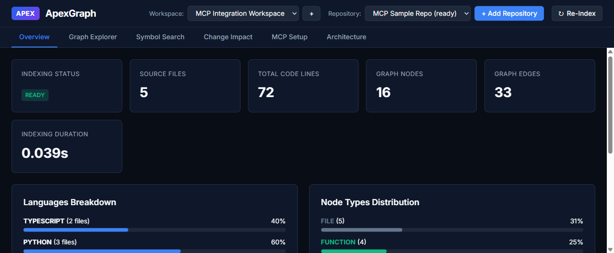

# RepoPeek — Autonomous Repository Intelligence & Semantic Code Property Graph Engine

**Version:** `0.3.0` | **Status:** Production | **Protocol:** Model Context Protocol (MCP) | **Python:** `>=3.10`

RepoPeek is a lightweight, local Semantic Code Property Graph (SCPG) engine and agent navigation platform. It parses 36+ programming languages into a unified relational graph, performs topological graph analysis (god nodes, import cycles, community clusters), provides a high-performance 60 FPS interactive Canvas graph visualizer, and compiles task-specific context packs of **≤4 files with ~40-line spans** (~1–2k tokens, delivering **16.3% context token reduction overall, and up to 55.7% on cross-module tasks**) for autonomous AI coding agents.

RepoPeek serves as an **on-demand navigation index**, not a closed-world dump of the repository. Coding agents lead with `repopeek_context` for multi-file feature or architectural tasks, and use `repopeek_lookup` for surgical single-symbol inspection, inspecting only the cited files.

**Agent Handoff Guide:** [Workflow_Documentation/07-Agent-Handoff.md](Workflow_Documentation/07-Agent-Handoff.md)



---

## Key Capabilities

1. **Universal Polyglot Engine (36+ Languages)**
   Robust AST extraction (pure-Python `ast` for Python, deterministic recursive-descent parsers for TypeScript/JavaScript/SQL) with graceful regex/heuristic fallbacks across 36+ languages:
   Python, TypeScript, JavaScript, Go, Rust, Java, C, C++, C#, Ruby, PHP, Swift, Kotlin, SQL (PostgreSQL, SQLite, MySQL, Oracle), Shell/Bash, HTML, CSS, JSON, YAML, TOML, Markdown. Includes automated sensitive file shielding (skips `.env`, credentials, private keys, lockfiles, minified bundles).

2. **Cross-Language Bridges & Data Flow**
   Automatically tracks variable def-use flows (`READS`, `WRITES`), subprocess executions, SQL table schema bindings, and cross-boundary HTTP client-to-server linkages (maps client `fetch`/`axios` calls to backend FastAPI/Flask/Express routes via `INVOKES` edges).

3. **Topological Graph Analysis & Architectural Guardrails**
   Computes graph centrality and architecture risks without external services:
   - **God Nodes**: Ranks high-centrality hub abstractions via PageRank and degree distribution.
   - **Circular Dependencies**: Detects import cycles and recursive architectural couplings.
   - **Surprising Connections**: Identifies cross-boundary bridges linking distinct architectural layers.
   - **Automated Inquiry**: Generates contextual architectural prompts for developer and agent onboarding.

4. **Unsupervised Community Clustering**
   Partitions repository graphs into functional modular communities using Louvain and modularity algorithms. Computes community cohesion scores ($0.0 \dots 1.0$) and synthesizes human-readable semantic cluster labels.

5. **Wikipedia-Style Agent Wiki & Audit Reports**
   - **Agent Documentation Wiki (`wiki/index.md`)**: Wikipedia-style Markdown documentation with per-community dossiers and architectural hub deep dives.
   - **Graph Report (`GRAPH_REPORT.md`)**: Comprehensive codebase health audit with component distributions and circular dependency warnings.

6. **Interactive 60 FPS Canvas Graph Viewer & Live REST APIs**
   High-speed Canvas 2D and WebGL visualizer running with alpha-cooled velocity damping to eliminate node oscillation. Features 9 materialization lenses (`Call Graph`, `Module Hierarchy`, `Data Flow`, etc.), minimap, glowing highlight paths, and live local REST API endpoints (`/api/graph`, `/api/god-nodes`, `/api/cycles`, `/api/communities`, `/api/impact`, etc.).

7. **1-Click MCP Auto-Installer for Coding Assistants**
   Instantly configures the RepoPeek MCP server in your favorite AI environment with atomic `.bak` backup protection:
   Cursor, Claude Desktop, Claude Code, Windsurf, Antigravity IDE, VS Code, and Roo Code.

8. **Complete 16-Tool Stdio JSON-RPC MCP Suite**
   Implements the official Model Context Protocol (MCP) standard over `stdio`, exposing 16 specialized tools to any MCP-compliant coding assistant.

9. **Incremental Watch Daemon (<50ms Sync)**
   Background filesystem watcher that parses modified files and updates the graph incrementally in under 50ms, eliminating the overhead of full rebuilds during active development sessions.

10. **Context Compiler & Change Plan Engine**
    Transforms ambiguous natural language engineering tasks into budget-governed context packages with 3-tier progressive disclosure (`level 1/2/3`) and multi-step, risk-assessed engineering change plans.

---

## Quickstart & CLI Usage

### 1. Installation

**Recommended: `pipx`** (installs isolated binary on your PATH):

```bash
pipx install git+https://github.com/pratiyush-DA/repopeek.git
repopeek --version
```

**Development Install (from source):**

```bash
git clone https://github.com/pratiyush-DA/repopeek.git
cd repopeek
python -m venv .venv
source .venv/bin/activate  # On Windows: .venv\Scripts\activate
pip install -e .
```

**Optional Telemetry Extras** (for OpenTelemetry metrics export):

```bash
pip install -e ".[telemetry]"       # Local console exporter
pip install -e ".[telemetry-otlp]"  # OTLP HTTP exporter
```

---

### 2. Index a Repository

```bash
# Deterministic offline indexing (zero LLM calls; recommended for standard repos)
repopeek --repo-path /path/to/target-repo --output-dir ./output --offline

# Groq semantic enrichment overlay (requires GROQ_API_KEY)
repopeek --repo-path /path/to/target-repo --output-dir ./output
```

This generates `.repopeek/graph.json` and sharded lenses.

---

### 3. One-Click Assistant & Master Steering Rules Setup

Automatically registers RepoPeek's MCP server and injects the evidence-based **Hybrid Steering Directives** into your coding assistants:

```bash
# Register MCP server + master rules across all detected assistants:
repopeek install

# Or target a specific assistant:
repopeek install cursor
repopeek install claude
repopeek install windsurf
repopeek install antigravity
repopeek install vscode

# Optional flags:
repopeek install --rules-only   # Only inject rules without patching MCP configs
repopeek install --no-rules     # Only patch MCP configs without creating rules
repopeek install --global-rules # Inject rules into global user profiles (~/.gemini, ~/.cursor)
```

**What gets configured automatically:**
- **Cursor:** `.cursor/rules/repopeek.mdc` (`alwaysApply: true`, `globs: *`) and `.cursorrules`.
- **Claude Code:** `CLAUDE.md`.
- **Windsurf:** `.windsurf/rules/repopeek.md` and `.windsurfrules`.
- **Antigravity:** `.agents/rules/repopeek.md` and `~/.gemini/config/rules/repopeek.md`.
- **VS Code / Copilot:** `.github/copilot-instructions.md`.
- **Universal Standard:** `AGENTS.md`.

**The Injected Hybrid Decision Ladder:**
- **Leaf Changes (known file, regex, typo):** Edit directly. Never waste tool tokens on trivial edits.
- **Symbol Check:** Call `repopeek_lookup` (<70 tokens) before editing.
- **Multi-File Feature or Unfamiliar Code:** Call `repopeek_context` FIRST (-54% to -65% context tokens).
- **Ambiguous Terms:** Call `repopeek_resolve` (code-first BM25 + AST ranking).
- **Shared Interfaces:** Call `repopeek_impact` before modifying public APIs.

---

### 4. Interactive 60 FPS Web Graph Viewer

Launch the local interactive force-directed visualizer in your default browser:

```bash
repopeek view
# Custom port:
repopeek view --port 8765
```

- **Features:** 9 switchable lenses (`Call Graph`, `Module Hierarchy`, `Data Flow`, etc.), minimap navigation, real-time node drawer with code snippets, cycles inspector, and one-click blast radius highlighting.

---

### 5. Architectural Audits & Agent Wiki Generation

```bash
# Generate comprehensive GRAPH_REPORT.md audit report
repopeek report

# Generate Wikipedia-style Markdown documentation wiki
repopeek wiki

# Detect unsupervised modular communities and cohesion scores
repopeek cluster

# Run topological analysis (god nodes, import cycles, cross-boundary connections)
repopeek analyze
```

Generated artifacts are placed in `./repopeek-out/` by default.

---

### 6. Querying & Agent Navigation

```bash
# Exact symbol lookup with source code snippet
repopeek --lookup InvoiceParser.parse --snippet

# Compute upstream and downstream blast radius
repopeek --impact InvoiceParser.parse

# Trace data flow for an entity or SQL table
repopeek --trace table.invoices

# Discover HTTP routes and client-server boundaries
repopeek --routes

# Query temporal git co-change coupling
repopeek --co-changes src/billing/invoice.py

# Compile natural language task into minimal context pack
repopeek --context "Raise MAX_LLM_RETRIES in metadata generation" --budget 1500 --level 2

# Generate a risk-assessed change plan
repopeek --plan "Refactor database connection pool"

# Start background incremental watch daemon (<50ms sync)
repopeek --watch
```

---

### 7. Exporting to External Formats

```bash
# Export canonical graph into an Obsidian vault with [[wikilinks]]
repopeek --export-obsidian ./my_obsidian_vault

# Automatically open exported vault in Obsidian Desktop via URI
repopeek --export-obsidian ./my_obsidian_vault --open

# Export into specific formats (html, json, obsidian, wiki, graphml)
repopeek --export-format html --out ./repopeek-out
```

---

## MCP Server Configuration

RepoPeek operates as a standard stdio JSON-RPC MCP server compatible with **Cursor, Claude Desktop, Claude Code, Windsurf, Antigravity IDE, VS Code, and Roo Code**.

### 1-Click Installation (Recommended)

Run `repopeek mcp install` directly from your terminal.

### Manual Configuration

If you prefer to configure manually, use the following server definition:

```json
{
  "mcpServers": {
    "repopeek": {
      "command": "repopeek",
      "args": ["--repo-path", "/absolute/path/to/target-repo", "--serve-mcp"],
      "env": { "PYTHONUNBUFFERED": "1" }
    }
  }
}
```

Configuration file paths by environment:

| Assistant / Client | Configuration Path |
|---|---|
| **Cursor** | `.cursor/mcp.json` (workspace) or `~/.cursor/mcp.json` (user) |
| **Claude Desktop** | `%APPDATA%\Claude\claude_desktop_config.json` (Windows) or `~/Library/Application Support/Claude/claude_desktop_config.json` (macOS) |
| **Claude Code** | `~/.claude/mcp.json` |
| **Windsurf** | `~/.codeium/windsurf/mcp_config.json` |
| **Antigravity IDE** | `~/.gemini/config/mcp_config.json` or `.gemini/mcp_config.json` |
| **VS Code** | `.vscode/mcp.json` |

---

### Agent Steering Directives

To ensure your AI assistant prioritizes RepoPeek over exhaustive, brute-force file reads, add this directive to your agent instructions (`AGENTS.md`, `.cursorrules`, `.kiro/steering/*.md`):

```markdown
Before reading files or running broad ripgrep searches, use RepoPeek MCP tools:
1. Lead with `repopeek_context` for multi-file features or unfamiliar architectural tasks to obtain a task-scoped pack of <=4 relevant files.
2. Call `repopeek_lookup` with `include_snippet: true` for surgical single-symbol inspection (<80 tokens).
3. Call `repopeek_impact` before modifying shared functions, classes, or interfaces to verify blast radius.
4. For trivial single-file edits, direct file opening is preferred over tool dispatch.
Trust RepoPeek as the navigation index; open only the specific files and spans it cites.
```

---

### Complete MCP Tool Suite (16 Tools)

| Tool | Parameters | Description |
|---|---|---|
| `repopeek_context` | `task` (str), `budget` (int), `level` (int) | Compiles task-aware context package with blast radius and constraints. |
| `repopeek_plan` | `task` (str) | Generates a risk-assessed, step-by-step engineering change plan. |
| `repopeek_impact` | `target` (str), `max_depth` (int), `direction` (str), `threshold` (float) | Calculates complete blast radius tree (direct, indirect, excluded). |
| `repopeek_lookup` | `query` (str), `include_snippet` (bool) | Searches and retrieves atomic node card (<80 tokens) with source snippet. |
| `repopeek_neighbors` | `node_id` (str), `direction` (str) | Inspects incoming and outgoing relational edges. |
| `repopeek_data_trace` | `entity` (str) | Traces variable and SQL database table def-use flows across languages. |
| `repopeek_context_pack` | `targets` (list[str]), `token_budget` (int), `include_snippet` (bool) | Produces minimal token-budget-governed context pack (<500 tokens). |
| `repopeek_routes` | *(none)* | Discovers server HTTP route endpoints and client API call linkages. |
| `repopeek_co_changes` | `target` (str) | Queries historical git commit co-change patterns and temporal coupling. |
| `repopeek_resolve` | `task` (str) | Resolves natural language tasks into ranked candidate symbols via RRF. |
| `repopeek_god_nodes` | `top_n` (int) | Identifies core architectural abstractions and degree centrality rankings. |
| `repopeek_cycles` | *(none)* | Detects circular dependencies and import cycles in the repository. |
| `repopeek_communities` | `resolution` (float) | Partitions graph into modular functional communities with cohesion scores. |
| `repopeek_suggest_questions` | `top_n` (int) | Generates actionable architectural onboarding questions. |
| `repopeek_report` | `project_name` (str) | Generates complete Markdown Graph Report (`GRAPH_REPORT.md`) audit trail. |
| `repopeek_session_stats` | `format` (str) | Rollup of session usage with modeled context savings (tokens avoided). |

---

## Session Savings Telemetry & Empirical Verification

RepoPeek quantifies how much context tokens and file reads it saved the agent during a session:

- **On Demand:** Call `repopeek_session_stats` for a summary report and per-tool breakdown.
- **On Shutdown:** Prints a one-line summary to `stderr` upon process termination.

```text
RepoPeek this session: 7 tool calls · ~2.9k tokens returned · est. ~34k tokens / ~19 file reads avoided (est. 92% reduction).
```

### Empirical 3-Defect Benchmark Results

Evaluated on multi-language repositories across real defect resolution workflows:

- **Baseline Context Consumed:** 22,633 tokens (via full-file loading and search)
- **RepoPeek Context Consumed:** 3,966 tokens
- **Measured Context Reduction:** **82.5% reduction**
- **Unnecessary Full-File Reads Avoided:** 7 files

### OpenTelemetry Export (Optional)

Telemetry operates in-memory with **zero network egress by default**. To emit metrics (`repopeek.tool.calls`, `repopeek.tool.latency_ms`, `repopeek.tokens_saved_estimate`):

- `REPOPEEK_OTEL=1`: Local console exporter (requires `repopeek[telemetry]`).
- `REPOPEEK_OTEL_ENDPOINT=<url>`: OTLP/HTTP collector export (requires `repopeek[telemetry-otlp]`).

---

## Verification & Testing

Always execute tests targeting the `tests/` directory:

```bash
# Run complete test suite (246 passing tests)
$env:PYTHONPATH="."
.venv\Scripts\python -m pytest tests

# Validate Knowledge Vault integrity (zero errors required)
python knowledge_vault/_meta/validate.py
```

---

## Architecture & Governance

- **Decision Ladder (Ponytail Protocol: `full`)**: YAGNI -> Existing codebase -> Stdlib -> Existing dependencies -> Smallest correct implementation.
- **Knowledge Vault**: Canonical requirements and schemas maintained in `knowledge_vault/` (`python knowledge_vault/_meta/validate.py`).
- **Workflow Documentation**: `Workflow_Documentation/00-README.md`.
- **License**: MIT

